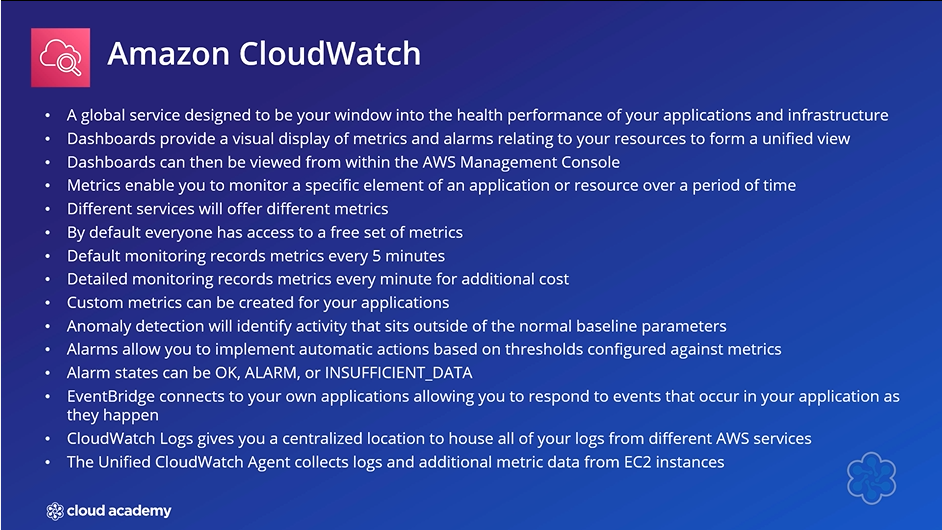
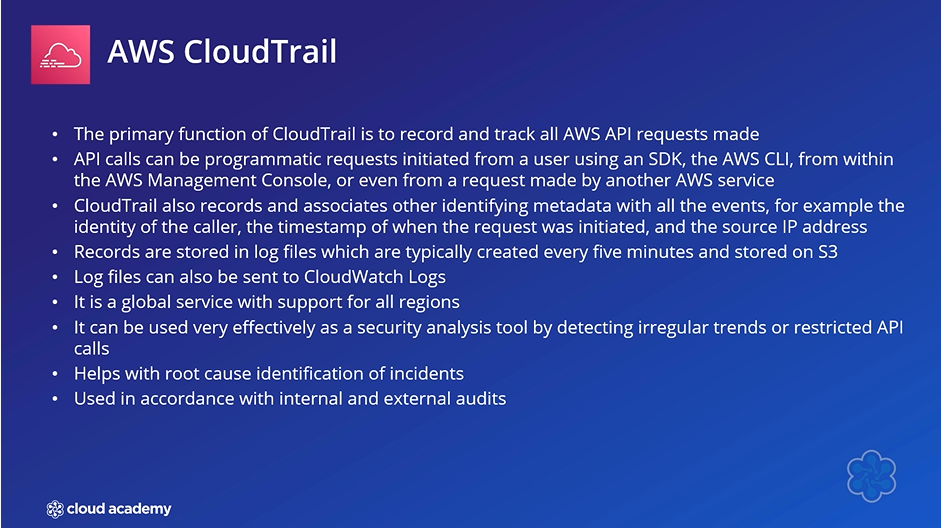
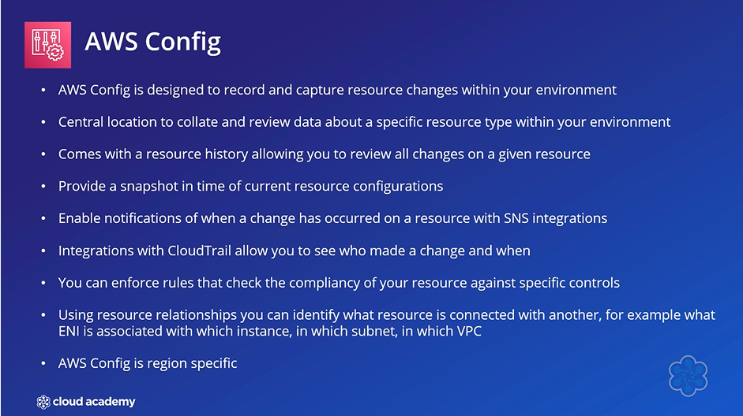
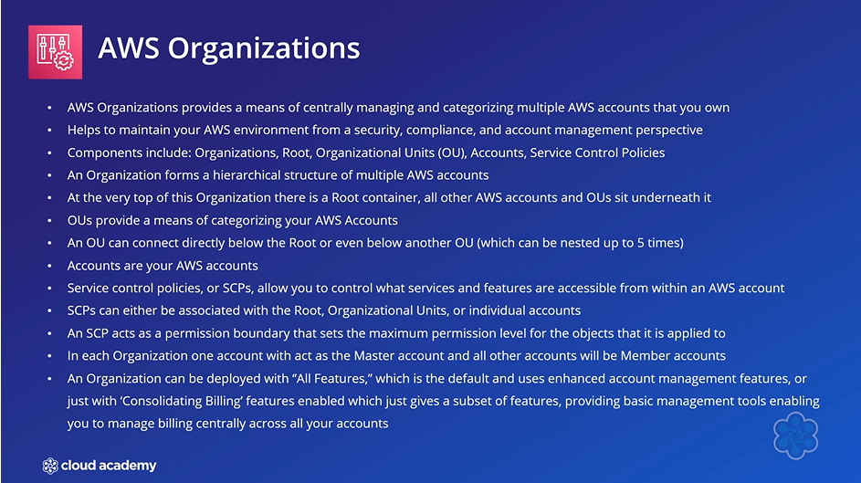
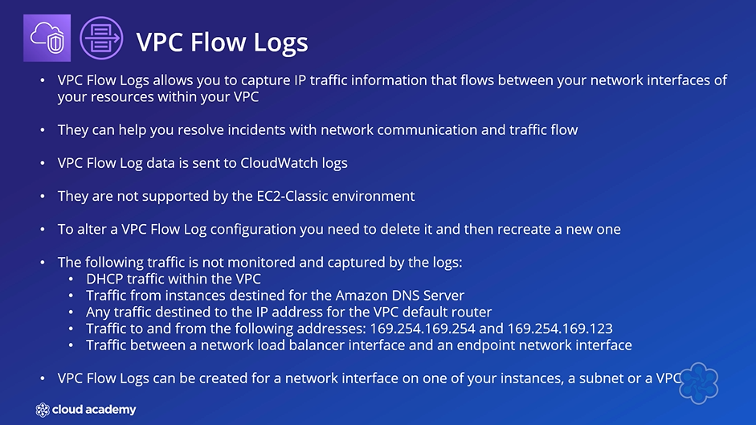
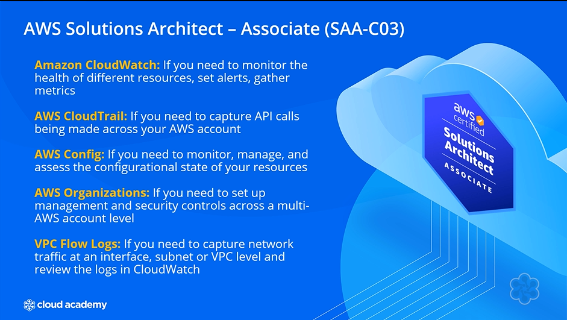

# 🛠️ AWS Management Services Summary

## 🧩 Overview

Several AWS management services are important for monitoring, auditing, compliance, account management, and network analysis.

Key services include:

- 📊 **Amazon CloudWatch**
- 📋 **AWS CloudTrail**
- ⚙️ **AWS Config**
- 🏢 **AWS Organizations**
- 🌐 **VPC Flow Logs**

Understanding the purpose of each service is important for the **AWS Solutions Architect exam**.

---

## 📊 Amazon CloudWatch

---

## 📋 AWS CloudTrail

---

## ⚙️ AWS Config

---

## 🏢 AWS Organizations

---

## 🌐 VPC Flow Logs

---

# 🎯 Exam Focus

---

## 🧠 Final Key Idea

**CloudWatch = Monitor**

**CloudTrail = Audit**

**AWS Config = Track configuration and compliance**

**AWS Organizations = Manage multiple accounts**

**VPC Flow Logs = Monitor network traffic**